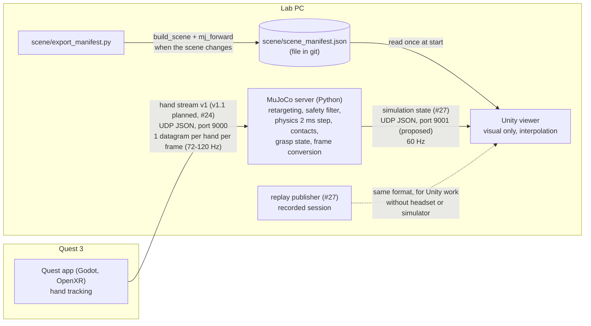

# Integration architecture: Quest 3 → MuJoCo → Unity

Issue #22, part of epic #21. This file says which component owns what, how
the data flows between them, where each frame conversion happens and what
happens when something fails. Field-level formats are in [DATA.md](DATA.md).

## Components

| Component | Code | Runs on | Owns | Does not do |
|---|---|---|---|---|
| Quest 3 app | `quest_app/` (Godot 4, OpenXR) | headset | reading hand tracking; the hand stream | physics, retargeting, any scene state |
| MuJoCo server | `teleop/` today; headless server from #25 | lab PC (or Mac) | the scene (`build_scene` in `teleop/run.py`), retargeting, safety filter, physics, contacts, grasp state (#26), every frame conversion, the state stream | rendering for the user (the MuJoCo viewer is a debug option) |
| Unity viewer | `unity_viz/` | lab PC monitor, or the headset (open question 1) | drawing the scene, interpolation between states, status display | physics: no Rigidbody, no Collider, no grasp logic, no frame math |

MuJoCo is the single source of truth. Unity only shows what MuJoCo says, and
it never sends anything back, so a slow Unity cannot slow the simulation.

## Data flow

## Streams

| Stream | From → to | Transport | Port | Rate | Format |
|---|---|---|---|---|---|
| Hand stream | Quest app → MuJoCo server | UDP, one JSON datagram per hand, broadcast or unicast | 9000 | one datagram per hand per rendered frame (headset refresh rate, 72-120 Hz) | [PROTOCOL.md](../hand-stream/PROTOCOL.md), summary in [DATA.md](DATA.md#1-hand-message-quest--mujoco) |
| Scene manifest | exporter → Unity | JSON file `scene/scene_manifest.json`, committed to git | none | written when the scene changes, read once when Unity starts | [DATA.md](DATA.md#2-scene-manifest-mujoco--unity-file) |
| Simulation state | MuJoCo server → Unity | UDP, one JSON datagram per message | 9001 (proposed) | 60 Hz, fixed (#25, #27) | [DATA.md](DATA.md#3-simulation-state-mujoco--unity), later `STATE_STREAM.md` (#27) |
| Replay | replay publisher → Unity | same as simulation state | 9001 (proposed) | 60 Hz | same as simulation state |

Inside the server the physics runs at a fixed 2 ms step (500 Hz). The
publish rate (60 Hz) does not depend on when hand packets arrive.

Network: when the server and Unity run on the same PC, the state stream goes
to `127.0.0.1`, which needs no firewall rule and no admin rights. The hand
stream from the headset to the PC is the hard part on the campus network
(see #7 and open question 4).

## Frames and where each conversion happens

| Frame | Axes | Handedness | Quaternion order | Used by |
|---|---|---|---|---|
| OpenXR stage (Godot tracking space) | +X right, +Y up, −Z forward; origin on the floor | right | (x, y, z, w) | hand stream |
| MuJoCo world | +Z up; the table is towards +Y | right | (w, x, y, z) | simulation, authoritative |
| Unity world | +Y up, +Z forward | left | (x, y, z, w) | scene manifest, simulation state |

All units are metres and radians in every frame.

Every conversion happens in Python on the MuJoCo side. Unity applies the
numbers as they are.

1. **OpenXR → MuJoCo**, in the server (`teleop/run.py`, `QUEST_TO_WORLD` and
   `Teleop.update`): `(x, y, z)_mujoco = (x, −z, y)_openxr`. This is a proper
   rotation (determinant +1). After it, re-centring turns the hand's forward
   direction to +Y and moves the wrist to `HOME` above the table. The hand
   orientation is built from joint positions (the palm frame in
   `teleop/retarget.py`); the joint quaternions of the hand stream are not
   used yet. #24 checks the wrist pose against this frame.
2. **MuJoCo → Unity**, in [`scene/frames.py`](../../scene/frames.py), used by
   [`scene/export_manifest.py`](../../scene/export_manifest.py) and later by
   the state publisher (#27):
   - position: `(x, y, z)_unity = (x, z, y)_mujoco`
   - quaternion: `(x, y, z, w)_unity = (−x, −z, −y, w)_mujoco`, where the
     MuJoCo quaternion is `(w, x, y, z)`
   - triangles: `(a, b, c)` becomes `(a, c, b)`

   Swapping Y and Z is a reflection (determinant −1). It turns the
   right-handed frame into a left-handed one, so a rotation axis changes sign
   and every triangle's winding is reversed.
3. **Unity**: no conversion.

Why in Python: there is one place to change, and it is unit-tested without
Unity. `scene/test_scene.py` checks that rotating then converting equals
converting then rotating, for random rotations, and that every cube triangle
faces outward in Unity.

## Timing

- `seq` in every message finds lost and out-of-order datagrams.
- The state message carries the simulation time and the server's send time,
  so lag between simulation and wall clock is visible.
- Unity draws a short, fixed delay behind the newest state and interpolates
  between the two states around that time: positions linearly, rotations
  with slerp. Proposed delay: 50 ms, three messages at 60 Hz; #29 measures
  it and writes the final value.

## Failure handling

| Failure | What the server does | What Unity does |
|---|---|---|
| Tracking lost (hand datagrams arrive with `tracked: false`) | ignores them and holds the hand's last pose; physics keeps running, so a held object stays held or falls | keeps applying states; shows the tracking status `lost_tracking` |
| Hand datagrams lost (none for 0.5 s, `TIMEOUT` in `teleop/run.py`) | holds the last pose; counts `seq` gaps | shows `no_packets` |
| Tracking comes back elsewhere | speed limits make the hand glide to the new pose instead of jumping (`Teleop.update`) | nothing special |
| State datagrams lost | — | interpolates across the gap; discards a late datagram whose `seq` is lower than the newest one received |
| Server silent (no state for 0.5 s, proposed) | — | freezes the last state and shows "no connection" |
| Server restarted (`seq` much smaller than the last one) | starts again from `seq` 0 | clears its buffer and starts again |
| Unity behind (slow frame, garbage collection) | not affected: Unity sends nothing back | the receiver thread keeps only the newest few states; each frame uses the pair around the render time, states older than that pair are dropped, and no queue builds up |
| Simulation behind real time | at most 50 ms of catch-up per frame (as today) | sees `sim_time` fall behind `send_time` |

## Open questions

I am asking these in person on 2026-11-03. The answers go into #22, and this
file is updated after that.

1. Does the Unity view run on the PC monitor or inside the Quest 3? Answer: pending.
2. Do we keep the Godot app for hand tracking, or move the Quest side to Unity? Answer: pending.
3. Is the Shadow Hand the right hand model for the demo? Answer: pending.
4. Is a Quest 3 available, and can the lab get admin rights or a small router, since the campus network blocks headset-to-PC traffic (#7)? Answer: pending.
